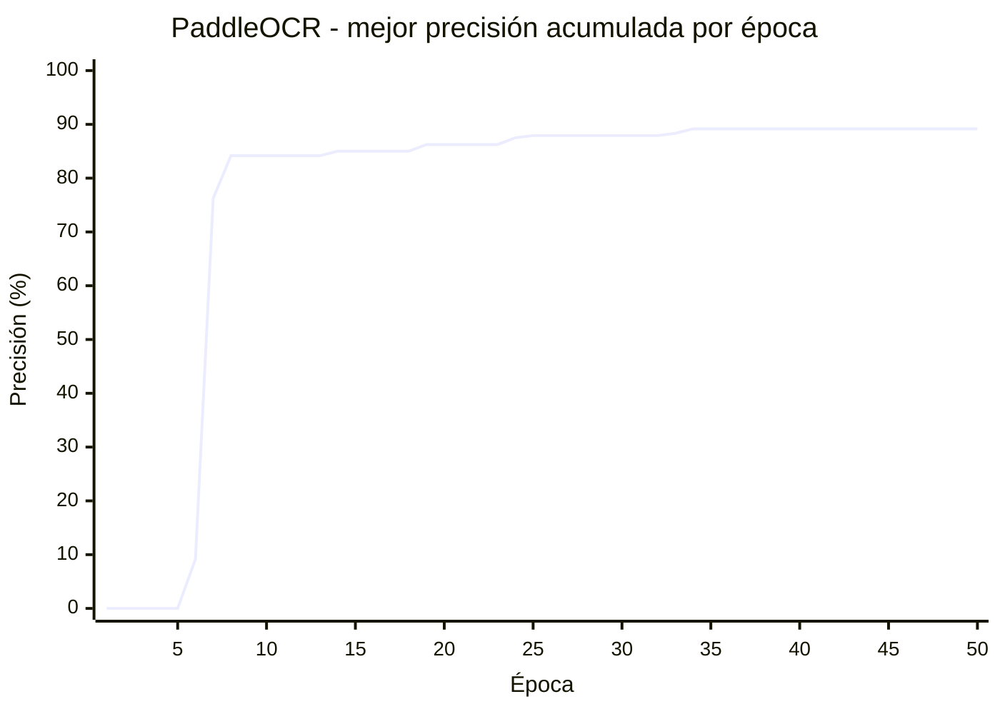
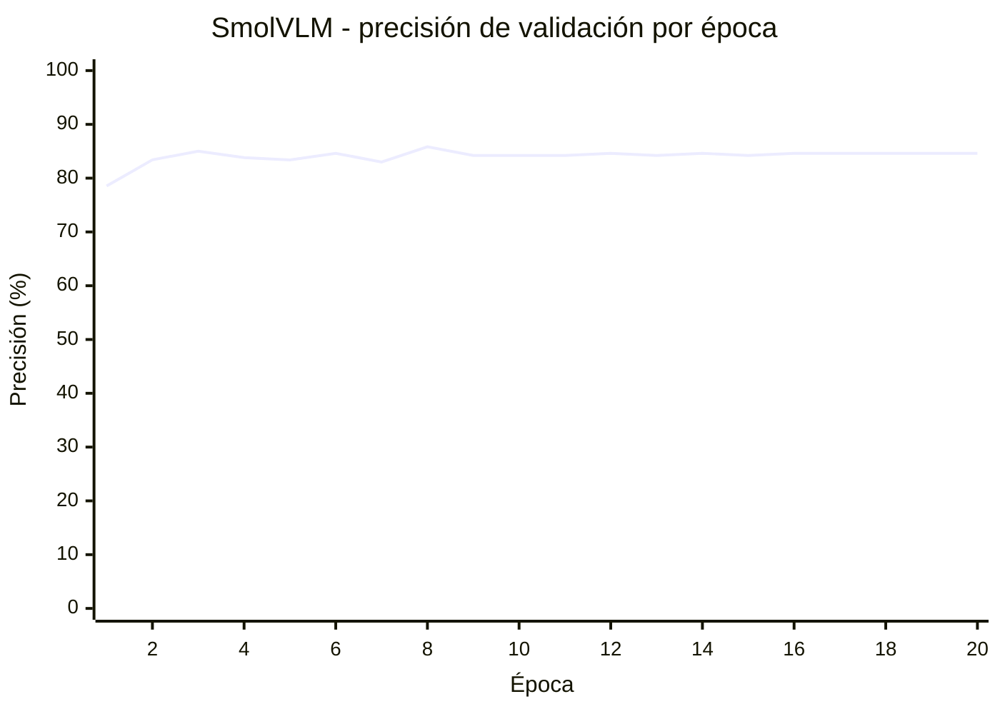
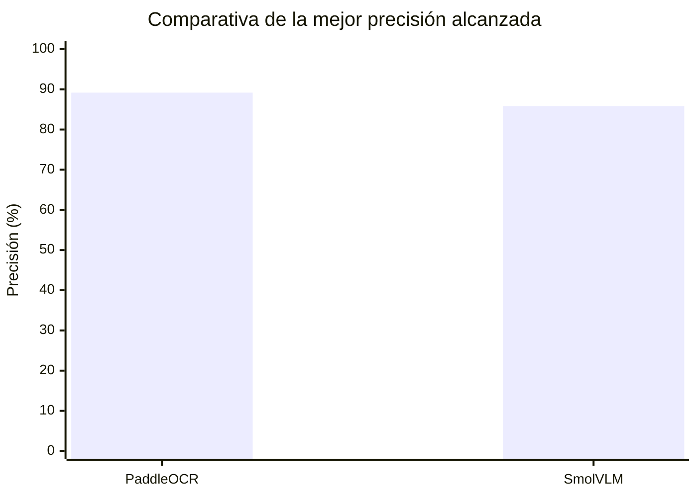

# VC_P4 - Reconocimiento y lector de matrículas

## Dataset utilizado

El dataset utilizado está formado por 2184 imágenes etiquetadas, las cuales contienen tanto la posición como los números de matrícula, que serán útiles para la segunda parte de la práctica. El dataset se puede descargar en el siguiente drive: [dataset](https://drive.google.com/file/d/1IETJJqb2CJnpKCwmm6MfeaVMvr0hM4vM/view?usp=drive_link)

Para importar el dataset en el proyecto, es necesario descargar tanto la carpeta `annotations/` con las etiquetas de las imágenes como la carpeta `images/`. Al descargar se genera un ZIP para las etiquetas y entre 3-4 ZIP para las imágenes, hay que extraerlo todo y añadirlo al repositorio. Será necesario un directorio `images/` para todas las imágenes y otro `labels/` para las etiquetas.

## Hardware del equipo utilizado

Todo el desarrollo de la práctica se realizó en un portatil con las siguientes características:

- CPU: AMD Ryzen 7 7735HS with Radeon Graphics.
- GPU: NVIDIA GeForce RTX 4050 Laptop, CUDA 12.6.
- RAM: 16GB DDR5 4800 MT/s

## Detección de matrículas (Modelo YOLO)

### Entorno de Anaconda para YOLO con Python 3.9.25

Dentro del entorno se instalaron las siguientes dependencias para el modelo YOLO:

```bash
conda create -n VC_YOLO python=3.9 -y
conda activate VC_YOLO

pip install torch==2.8.0 torchvision==0.23.0 --index-url https://download.pytorch.org/whl/cu126
pip install ultralytics==8.4.200 ipykernel==6.31.0 jupyter==1.1.1 jupyterlab==4.5.11 notebook==7.5.8
```

### Reparto de imágenes del dataset

Con el entorno de Anaconda iniciado y el dataset en el repositorio, se procede con la ejecución del código para el entrenamiento y prueba del modelo YOLO en la detección de matrículas, ubicado en el cuaderno `YOLO_P4.ipynb`.

La primera celda de código está destinada al reparto de las imágenes del dataset, por lo que solo será necesario ejecutarlo la primera vez que se importa. Este genera un nuevo directorio llamado `dataset/`, el cual reparte todas las imagenes en otros tres subdirectorios `train/` (80%), `test/` (10%) y `val/` (10%).

El código va emparejando cada imagen con su etiqueta buscando los ficheros que contengan el mismo nombre, para posteriormente mezclar estas parejas aleatoriamente a través de una semilla en cada subdirectorio.

### Detección de matrículas con modelo YOLO (`YOLO_P4.ipynb`)

Una vez generado el directorio `dataset/`, se procede con la importación de los paquetes en el código para la ejecución del entrenamiento y manejo de YOLO. Aunque es necesario primero convertir las etiquetas de `.json` a `.txt` para que el modelo pueda usarlas. 

#### Configuración del modelo YOLO

Posteriormente, se configura el modelo para ejecutar el entrenamiento correctamente con los siguientes parámetros: 

- `path` para localizar el directorio `dataset/`; `train` para las imágenes de entrenamiento en `dataset/train/`, con las que el modelo irá aprendiendo en cada época.

- `val` para las imágenes de evaluación en `dataset/val/`, estas imágenes permiten realizar una pequeña prueba al final de cada época para evaluar el rendimiento del modelo, permitiendo realizar ajustes a partir de sus resultados para la siguiente época.

- `test` para las imágenes de prueba final en directorio `dataset/test/`, con las que se probará el modelo final alcanzado en la última época, su objetivo es valorar el rendimiento que tendrá el modelo cuando se empiece a probar con imágenes nuevas.

- `names` cuyo valor es `plate` para el tipo `0`. Esto se traduce en que cuando el modelo detecte un objeto lo llamará `plate`. El `0` indica que se trata del primer objeto que busca, al ser un modelo destinado únicamente a matrículas no es necesario añadir ningun número más.

#### Entrenamiento del modelo YOLO

Con la configuración realizada, se procede con la función `train()`. Para este modelo y dataset se ejecutaron dos entrenamientos: uno simple y otro con `data augmentation`. Ambos entrenamientos parten de 100 épocas con 20 de paciencia, que se traduce en que si no se ve una mejora del modelo en máximo 20 épocas, se detiene el entrenamiento. 

Por otro lado, el parámetro `imgz` se utiliza para reescalar las imagenes a 960px. Este valor se debe a que al intentar utilizar imágenes más pequeñas para agilizar el entrenamiento, se podían volver irreconocibles las matrículas más pequeñas, generando falsos negativos. Y de otra forma, si se intentaba aumentar el tamaño a 1280px se desbordaba la memoria de mi GPU. 

El parámetro `batch` indica el número de imágenes que se procesan a la vez, aumentar o reducir este valor es importante para evitar los desbordamientos de memoria y agilizar lo máximo posible el entrenamiento. En mi caso, utilicé un valor de `4` ya que aumentarlo me generaba error en la memoria y reducirlo volvía demasiado lento el entrenamiento.

Finalmente, los resultados se guardan en un nuevo directorio llamado `results`, para el entrenamiento base utilicé el nombre `plate-detection` en el parámetro `name`; mientras que para el segundo entrenamiento con `data augmentation` utilicé `plate-detection-augmentation`.

En el caso de `plate-detection-augmentation`, que es el que se muestra en el cuaderno, los parámetros utilizados fueron los de la siguiente tabla:

| Parámetro | Defecto | Data augmentation | Categoría | Qué hace |
|---|---|---|---|---|
| `hsv_h` | 0.015 | 0.015 | Color | Cambia el tono (color base) de la imagen, hasta ±1.5 % de la rueda de color. |
| `hsv_s` | 0.7 | 0.6 | Color | Cambia la saturación, hasta ±N×100 %. |
| `hsv_v` | 0.4 | 0.5 | Color | Cambia el brillo, hasta ±N×100 %. |
| `degrees` | 0.0 | 5.0 | Geometría | Rota la imagen hasta ±N grados. |
| `translate` | 0.1 | 0.1 | Geometría | Desplaza la imagen hasta ±10 % de su tamaño. |
| `scale` | 0.5 | 0.5 | Geometría | Agranda o encoge la imagen hasta ±50 %. |
| `shear` | 0.0 | 2.0 | Geometría | Inclina la imagen en diagonal, hasta ±N grados. |
| `perspective` | 0.0 | 0.0005 | Geometría | Simula un cambio de punto de vista. |
| `fliplr` | 0.5 | 0.0 | Geometría | Probabilidad de voltear la imagen horizontalmente (espejo). |
| `mosaic` | 1.0 | 1.0 | Mezcla | Probabilidad de combinar 4 imágenes en una. |
| `mixup` | 0.0 | 0.1 | Mezcla | Probabilidad de superponer dos imágenes con transparencia. |
| `erasing` | 0.4 | 0.3 | Política | Probabilidad de borrar un trozo aleatorio de la imagen. |
| `close_mosaic` | 10 | 10 | Mezcla | Desactiva el mosaico en las últimas 10 épocas del entrenamiento. |

#### Resultados de los entrenamientos del modelo YOLO

Una vez entrenado del modelo se procede con la prueba final utilizando el subdirectorio `dataset/test/`. Los valores finales obtenidos de los entrenamientos muestran los siguientes resultados:

| Métrica | Normal | Con augmentation | Diferencia |
|---|---|---|---|
| Precisión | 0.888 | 0.889 | igual |
| Recall | 0.707 | 0.713 | +0.006 |
| mAP50 | 0.712 | 0.722 | +0.010 |
| mAP50-95 | 0.436 | 0.406 | −0.030 |
| Mejor mAP50 (época) | 0.721 (81) | 0.729 (94) | +0.008 |
| Mejor mAP50-95 (época) | 0.442 (99) | 0.414 (84) | −0.028 |
| `box_loss` en entrenamiento (ép. 100) | 1.20 | 1.26 | +0.06 |
| `box_loss` en validación (ép. 100) | 1.31 | 1.42 | +0.11 |

Además de esta tabla, se generaron los siguientes gráficos:

[Resultados YOLO base](results/plate-detection/results.png)
[Resultados YOLO con data augmentation](results/plate-detection-augmentation/results.png)

A raíz de los datos compartidos, se puede observar como los resultados de ambos modelos son prácticamente iguales, con una pequeña mejora en el de data augmentation. En cuanto a los valores de detección se puede apreciar una ligera ventaja en data augmentation, con mejores valores en mAP50 y recall. Por otro lado, ambas matrículas detectan la misma proporción de matrículas y dejan escapar casi un 30% de estas (recall). El motivo puede ser debido al tamaño de ciertas matrículas en el dataset, siendo demasiado pequeñas, borrosas o en un ángulo complicado de detectar.

En cuanto al valor mAP50-95, que indica el ajuste de la caja (matrícula), se puede apreciar un mejor desempeño en el modelo base. Este valor indica que la caja que predice el modelo es prácticamente igual a la caja marcada manualmente en las etiquetas del dataset. De todas formas, este resultado no indica que el modelo con data augmentation no encuentre las matrículas, sino que simplemente el cuadrado no es tan preciso. Este valor también justifica los valores `box_loss`, que indican la pérdida en cuanto a la precisión de las cajas.

Pasando con la velocidad de aprendizaje, se observa un desempeño más lento con data augmentation debido a los distintos filtros que modifican las imágenes entre épocas. No obstante, este segundo modelo no se estanca como sí ocurre con el modelo base, llegando a superarlo en el mAP50 en las últimas épocas. Los gráficos sugieren que de haber añadido más épocas, el segundo modelo podría superar al base.

Finalmente, se puede apreciar una tendencia al sobreajuste en las últimas épocas del modelo base debido a una brecha entre el entrenamiento y la validación, señal de que el modelo empieza a memorizar. Por el contrario, el modelo con data augmentation muestra unas curvas más igualadas durante todo el entrenamiento.

En base a todo lo comentado, se puede llegar a una conclusión sobre qué modelo utilizar, si lo que se busca es la caja más ajustada, es preferible el entrenamiento normal; si por el contrario se busca generalizar mejor y se puede entrenar durante más épocas, el de data augmentation.

#### Prueba final del modelo en un vídeo

Para la prueba final se utilizó este [vídeo](https://ulpgc-my.sharepoint.com/personal/mcastrillon_iusiani_ulpgc_es/_layouts/15/stream.aspx?id=%2Fpersonal%2Fmcastrillon%5Fiusiani%5Fulpgc%5Fes%2FDocuments%2FRecordings%2FC0142%2EMP4&ga=1&share=cQp0bJ6%2DGLkPQq4XHpEzwA%5FGEgUCbGUicnP93So3tDpcv8c50Q&referrer=StreamWebApp%2EWeb&referrerScenario=AddressBarCopied%2Eview%2E316dd0e7%2D950a%2D4304%2D9f8d%2D7747aa932c4c), el cual muestra una vía pública donde van pasando vehículos y personas. El objetivo de la prueba consiste en las siguientes tareas:

- Detectar tanto personas como cualquier vehículo.
- Implementar un seguimiento para todos los objetivos.
- Realizar un conteo de cada clase, indicando además en que dirección van al salir de la escena.
- Detectar matrículas utilizando el modelo previamente entrenado.
- Anonimizar tanto personas como vehículos.
- Comparar la detección de YOLO con una de contornos.

El resultado final se puede encontrar en el siguiente [vídeo]() de YouTube. Y los valores de conteo obtenidos fueron:

Total por clase:
- autobus: 1
- bicicleta: 1
- camion: 1
- coche: 94
- moto: 3
- persona: 20
- vehículos con matrícula detectada: 54

Flujo por dirección de movimiento:
- autobus -> izquierda: 1
- bicicleta -> izquierda: 1
- camion -> estatico: 1
- coche -> derecha: 5
- coche -> estatico: 66
- coche -> izquierda: 23
- moto -> estatico: 1
- moto -> izquierda: 2
- persona -> derecha: 9
- persona -> estatico: 6
- persona -> izquierda: 5

Detección de matrículas en dataset/test:
- Contornos: recall=0.14  precisión=0.04  detecciones=2330
- YOLO: recall=0.77  precisión=0.86  detecciones=428

Cabe mencionar un pequeño problema surgido durante la prueba. Al principio se daba el caso en el que al pasar un vehículo por delante de los que están aparcados, el modelo perdía su rastro y lo detectaba como un nuevo vehículo aumentando drásticamente el ID hasta en más de 700 coches. Para solucionarlo, se creó un nuevo `tracker` a partir de `bytetrack`, el utilizado anteriormente. Este nuevo permite conservar el identificador de un vehículo en un periodo de tiempo de unos 3 segundos, con un umbral de movimiento reducido pero que también ayuda a no perder su seguimiento si este se mueve un poco. Gracias a esto, el problema se consiguió reducir bastante aunque aún infla un poco las cifras de los vehículos.

El vídeo se puede ver a través del siguiente enlace: [vídeo YOLO](https://youtu.be/toief6wNAtE).

## Lector de matrículas

### Obtención de las matrículas del dataset

Para que el modelo pueda aprender a leer correctamente las matrículas del coche fue necesario realizar un ajuste en el dataset que ya se tenía. Para ello, la primera celda del cuaderno `PaddleOCR_P4.ipynb` recorta las matrículas y genera nuevas imágenes legibles para este modelo. No obstante, todas las imágenes no eran válidas debido al tamaño de la matrícula, distancia o que no tuviera el número de matrícula anotado en la etiqueta.

### Modelo PaddleOCR

#### Problema con el primer entorno de Anaconda para PaddleOCR

Al principio se intentó instalar todas las dependencias de PaddleOCR dentro del entorno para YOLO. No obstante, al intentar ejecutar el entorno de PaddleOCR se producía un error de compatibilidad con torch, por lo que se decidió crear un nuevo entorno exclusivo para este modelo OCR, así como para el modelo de VLM.

#### Nuevo entorno Anaconda para PaddleOCR con Python 3.9.25

El nuevo entorno de Anaconda para el modelo PaddleOCR contiene las siguientes dependencias:

```bash
conda create -n VC_PaddleOCR python=3.9 -y
conda activate VC_PaddleOCR

python -m pip install paddlepaddle-gpu==3.3.1 -i https://www.paddlepaddle.org.cn/packages/stable/cu126/
python -m pip install paddleocr==3.7.0
python -m pip install -r PaddleOCR/requirements.txt
python -m pip install ipykernel matplotlib
```

`PaddleOCR/requirements.txt` incluye: shapely, scikit-image, pyclipper, lmdb, tqdm, numpy, rapidfuzz, opencv-python, opencv-contrib-python, cython, Pillow, pyyaml, requests, albumentations, albucore, packaging.

#### Entrenamiento y resultados de PaddleOCR (`PaddleOCR_P4.ipynb`)

A partir de los recortes de matrícula generados en el paso anterior, el dataset se dividió en `plates/train.txt` (2109 imágenes) y `plates/val.txt` (246 imágenes). El modelo exacto utilizado fue uno preentrenado llamado `PP-OCRv5_mobile_rec`, su selección se debe a que se trata en primer lugar de la versión más reciente (`v5`), además de utilizar `mobile` en lugar de `server` porque el primero es más ligera, pudiendo ejecutarse en casi cualquier dispositivo. Por último, la parte `rec` indica que se trata de un modelo para el reconocimiento de texto.

Los parámetros utilizados para el entrenamiento fueron los siguientes

| Parámetro | Valor | Qué hace |
|---|---|---|
| Épocas | 50 | Número de recorridos del conjunto de entrenamiento |
| Optimizador | Adam (β1=0.9, β2=0.999) | Decide cómo se ajustan los pesos en cada paso a partir de los gradientes de la pérdida. β1 suaviza la dirección del gradiente y β2 la magnitud al cuadrado |
| Learning rate | 0.0001, con `warmup` de 5 épocas y planificación `Cosine` | El primer valor indica cuánto se mueven los pesos máximo en cada actualización; `warmup` aumenta el LR desde 0 gradualmente durante las 5 primeras épocas; `Cosine` indica que tras el calentamiento, el LR va bajando siguiendo una curva de coseno hasta llegar a 0 casi al final del entrenamiento|
| Regularización | L2 (factor 3·10⁻⁵) | Evita que los pesos crezcan demasiado, reduciendo el sobreajuste |
| Tamaño de imagen | 48×320 | Se redimensiona la imagen |

Durante el entrenamiento se evaluó el modelo cada 100 iteraciones sobre `val.txt`, guardando el mejor punto en función de la métrica `acc` (coincidencia exacta de la matrícula). Los resultados muestran una mejor precisión en la época 34 con una precisión de 0.8917.

A continuación, se mostrará una gráfica que indica la mejor precisión alcanzada en cada época:



En esta gráfica se observa una mejora muy rápida entre las épocas 6 y 8 (del 0 % al 84 %), seguida de una fase de ajuste fino mucho más lenta hasta estabilizarse en el 89.17 % a partir de la época 34, sin señales de sobreajuste gracias al `warmup` y la planificación `Cosine` del learning rate.

#### Prueba vídeo final PaddleOCR

El resultado de la prueba final se puede ver a través del siguiente [vídeo](https://youtu.be/NgJa7zVJiIk). En un apartado más adelante se comentarán los resultados obtenidos en los `.csv` de PaddleOCR y SmolVLM.

### Modelo SmolVLM

#### Creación de entorno Anaconda para SmolVLM

El entorno conda destinado al uso del modelo SmolVLM está formado por los siguientes comandos:

```bash
conda create -n VC_SmolVLM python=3.11 -y
conda activate VC_SmolVLM

pip install torch torchvision --index-url https://download.pytorch.org/whl/cu128
pip install transformers accelerate pillow num2words ipykernel opencv-python
```

#### Entrenamiento y resultados de SmolVLM (`SmolVLM_P4.ipynb`)

El modelo concreto utilizado fue `HuggingFaceTB/SmolVLM-256M-Instruct` utilizando el mismo reparto de matrículas (`train`: 2110 imágenes, `val`: 247 imágenes), pidiéndole al modelo que devuelva el texto de la matrícula a partir de la imagen recortada. El motivo del uso de este modelo concreto se debe a que `256M` indica que se trata del modelo más pequeño, si se intentara utilizar otro más grande el dispositivo podría no soportarlo. Por otro lado, `Instruct` indica que se trata de un modelo preparado para seguir instrucciones, facilitando además el `fine-tuning`.

| Parámetro | Valor | Qué hace |
|---|---|---|
| Épocas | 20 | Número de recorridos del conjunto de entrenamiento |
| Batch size | 8 | Número de imágenes procesadas a la vez antes de actualizar los pesos |
| Learning rate | 5·10⁻⁵ | Tasa de aprendizaje (cuánto se mueven los pesos como máximo) |
| Optimizador | AdamW (weight decay 0.01) | Regularizador estándar para los pesos en `fine-tuning` |
| Precisión | bf16 | Formato para los cálculos numéricos |

Al final de cada época se calculó la precisión exacta (`val acc (exacta)`) comparando el texto generado con la etiqueta real:



La mejor precisión se obtuvo en la época 8 con un 0.8583, que prácticamente no varía en las siguientes épocas (entre 84.2 % y 84.6 %). Sin embargo, la pérdida de entrenamiento cae casi a 0 a partir de la época 9 (de 0.25 en la época 2 a 0.0001 en la época 20), lo que indica que el modelo memoriza el conjunto de entrenamiento mucho antes de que la precisión en validación deje de mejorar: a partir de la época 8-9 el entrenamiento adicional ya no aporta generalización y está sobreajustando.

#### Resultado prueba de vídeo para SmolVLM

El siguiente [vídeo](https://youtu.be/S1Akz7nTfSw) muestra el resultado final de la prueba para el modelo SmolVLM. A continuación, en el siguiente apartado se realizará una serie de comparativas sobre los dos modelos utilizados para la lectura de matrículas.

### Comparativa final PaddleOCR vs SmolVLM

#### Resultados de los entrenamientos

En primer lugar se compararán los entrenamientos realizados:

| | PaddleOCR (`PP-OCRv5_mobile_rec`) | SmolVLM (`SmolVLM-256M-Instruct`) |
|---|---|---|
| Tipo de modelo | Red de reconocimiento de texto especializada (CTC + NRTR) | Modelo de visión-lenguaje genérico (256M parámetros) |
| Épocas entrenadas | 50 | 20 |
| Mejor precisión exacta en validación | **89.17 %** (época 34) | 85.83 % (época 8) |
| Comportamiento tras el pico | Estable, sin sobreajuste | Sigue entrenando pero empeora/estanca (sobreajuste) |
| Velocidad de inferencia | ≈ 252 fps (modelo ligero) | Mucho más lenta (modelo generativo, varios órdenes de magnitud más pesado) |



Ambas métricas miden la coincidencia exacta de la matrícula sobre el mismo dataset, no obstante, PaddleOCR termina por delante por casi 3.5 puntos porcentuales y, al ser un modelo pequeño diseñado específicamente para lectura de texto, resulta muchísimo más rápido en inferencia que un modelo como SmolVLM con la variane de 256M de parámetros. 

Sin embargo, SmolVLM alcanza una precisión bastante competitiva (85-86 %) con muchas menos épocas de entrenamiento, aunque empieza a sobreajustar a partir de la época 8-9, por lo que un entrenamiento más corto (o con `early stopping`) habría bastado para obtener el mismo resultado. Para esta tarea concreta, parece que un modelo de reconocimiento especializado como PaddleOCR es más adecuado: es más preciso, mucho más rápido y más barato de entrenar y desplegar que un VLM de propósito general.

#### Resultados del vídeo final

En cuanto a los resultados obtenidos del vídeo final volcados en los ficheros `results/plate-ocr/tracking_final.csv` (PaddleOCR) y `results/plate-ocr-smol/tracking_final.csv` (SmolVLM), ambos generados sobre el mismo vídeo y el mismo tracking (38 vehículos con al menos una lectura de matrícula, de 20.747 frames analizados). Se puede obtener la siguiente tabla:

| Métrica | PaddleOCR | SmolVLM |
|---|---|---|
| Vehículos con lectura de matrícula | 38 | 38 |
| Tasa media de detección por vehículo | 39.9% | 40.0% |
| Lecturas de texto distintas por vehículo (media) | 50.0 | 48.9 |
| Consistencia media (lectura más repetida / detecciones) | **22.7%** | 18.7% |
| Vehículos con una única lectura en todo el tracking | 2.6% | 2.6% |

Los valores obtenidos son prácticamente los mismos en ambos casos, PaddleOCR es ligeramente más consistente frame a frame, ya que al revisar los vídeos se puede apreciar como SmolVLM varía demasiado los valores de las matrículas antes de mostrar el correcto. Este fenómeno no ocurre con PaddleOCR, que tarda un poco menos en obtener la matrícula correcta y se mantiene durante prácticamente toda su exposición en el video. Por tanto, se puede concluir que, para esta tarea, el modelo PaddleOCR ha tenido un mejor desempeño a cambio de un entrenamiento más largo.